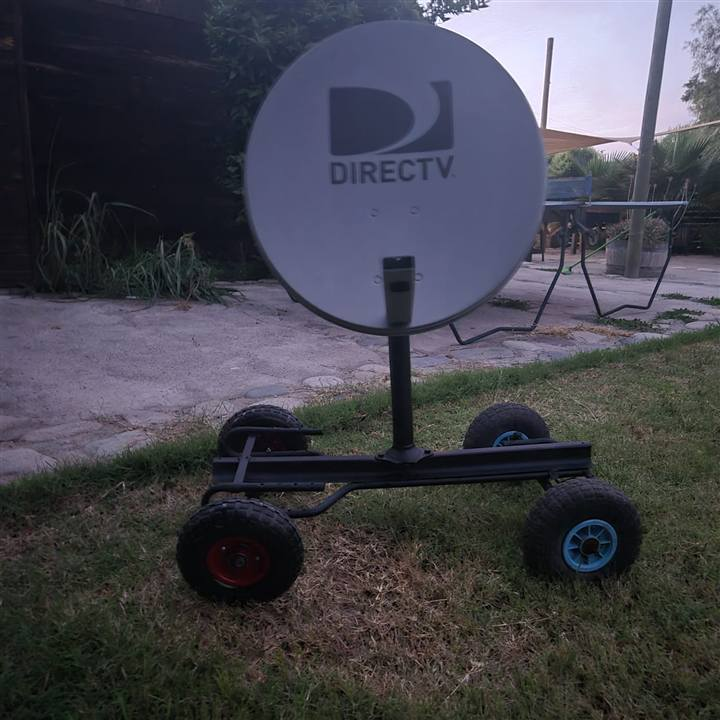
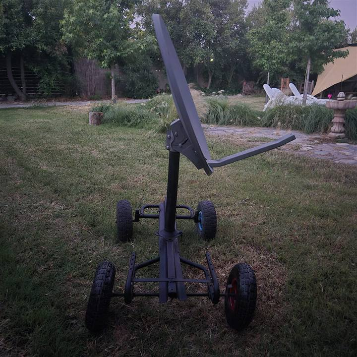
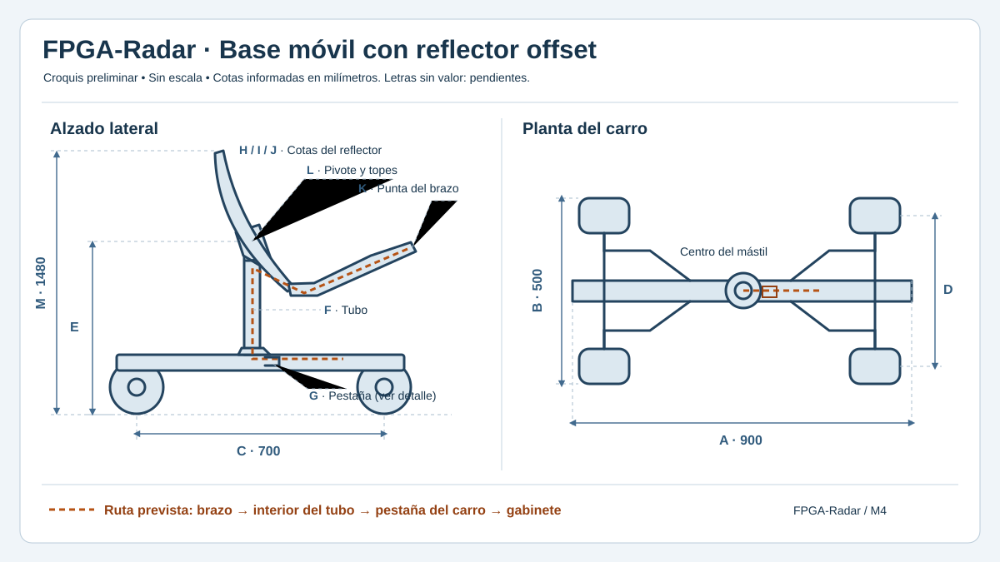
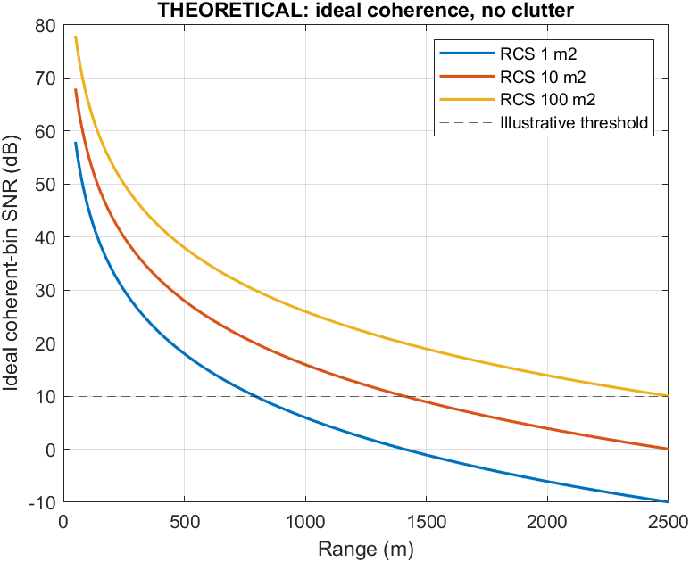
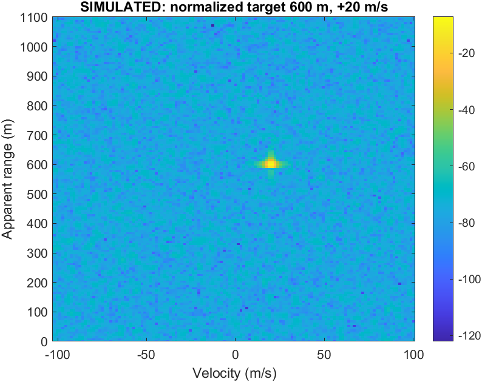
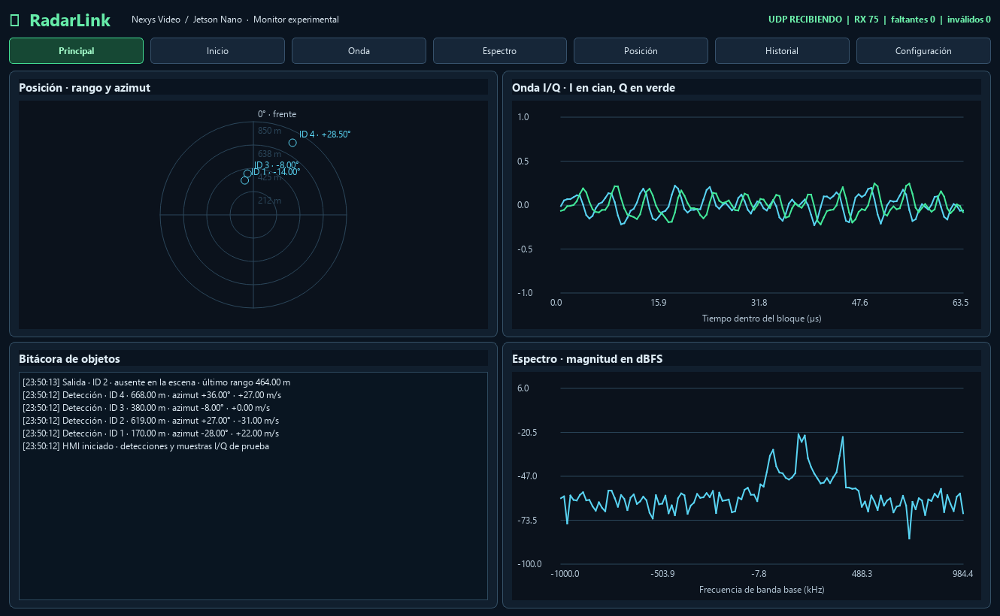
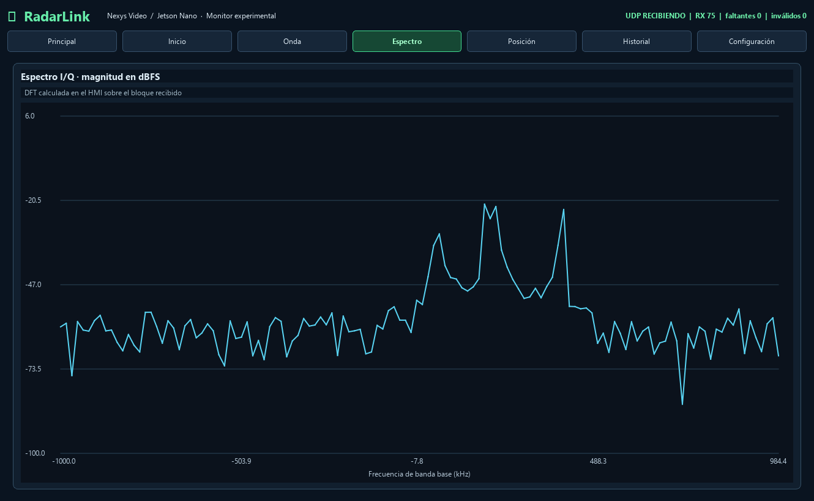
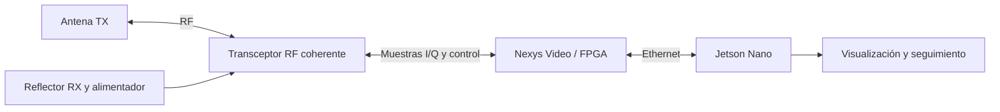

# FPGA-Radar

> **Estado:** Investigación y diseño preliminar · **Versión documental:** v0.3.0 · **Última revisión:** 2026-11-24

Proyecto de investigación y desarrollo de un radar coherente con procesamiento digital en FPGA (**Digilent Nexys Video, Artix-7 XC7A200T**) y unidad de supervisión **NVIDIA Jetson Nano**. La meta es detectar vehículos a una distancia de hasta **1 km**, utilizando sensores de radiofrecuencia amplificados por antenas de topologías apropiadas, identificación de patrones en tiempo real, mitigación de ruido por fourier para identificación más precisa.

## Prototipo de base móvil

El reflector se monta en un carro de cuatro ruedas de **90 × 50 cm**, con **70 cm entre ejes**, **1,48 m de altura total** en la posición medida y ajuste manual de **azimut y elevación**. El cableado está previsto por dentro del mástil y por la pestaña central del carro.

| Vista frontal | Vista lateral |
|:---:|:---:|
|  |  |

[Fotos de detalle, cotas y ruta de cables](docs/05-antenas/base-movil.md) · [Plan modular](ROADMAP.md)

## Resultados del estudio MATLAB

Figuras exportadas por [el estudio S1 en MATLAB R2024b](simulation/reports/2026-11-14-matlab-estudio-inicial.md). El perfil usa una frecuencia candidata de **2,45 GHz**, un chirp de **20 MHz** y **128 chirps** por trama.

### SNR frente a distancia · cálculo teórico

La caída de las curvas sigue la dependencia **1/R⁴** del modelo. A 1 km, con una sección radar (RCS) hipotética de **10 m²**, el cálculo estima **15,95 dB** en el bin con integración coherente ideal. El umbral de **10 dB** es ilustrativo. El alcance de 1 km sigue pendiente de validación en campo.

### Rango y velocidad · simulación sintética

Con un blanco sintético de **600 m y +20 m/s**, el pico de la FFT 2D dio **598,94 m** tras corregir el acoplamiento rango–Doppler y **+20,71 m/s**. El eje vertical de la figura muestra el rango aparente. El ensayo usa amplitud normalizada para comprobar la estimación del algoritmo.

[Informe, supuestos y datos de salida](simulation/reports/2026-11-14-matlab-estudio-inicial.md) · [Código MATLAB del estudio](simulation/matlab/run_study.m) · [RF, muestreo y reloj FPGA](docs/06-procesamiento/frecuencias-y-modelo-matlab.md)

## RadarLink · interfaz de operación

Capturas del HMI ejecutado con una **reproducción local de escenas FMCW sintéticas**. La pestaña Principal reúne posición, onda I/Q, espectro y bitácora. La pestaña Espectro muestra en detalle la transformada del bloque I/Q.

[Código Python e instrucciones de ejecución](jetson/src/README.md)

## Empieza aquí

1. [Guía de lectura](docs/README.md)
2. [Objetivos y alcance](docs/01-introduccion/objetivos-y-alcance.md)
3. [Requisitos y trazabilidad](docs/03-requisitos/requisitos.md)
4. [Arquitectura del sistema](docs/04-arquitectura/arquitectura-general.md)
5. [Presupuesto de enlace preliminar](docs/02-fundamentos/presupuesto-enlace.md)
6. [Antena DirecTV de 46 cm](docs/05-antenas/reflector-directv.md)
7. [Bitácora de avances](progress/README.md)
8. [Decisiones de arquitectura (ADR)](docs/decisiones/README.md)
9. [Hoja de ruta](ROADMAP.md)

## Simulación — acceso directo

| Estudio | Qué encontrarás | Estado |
|---|---|---|
| [Índice de simulación](simulation/README.md) | Ruta de lectura y todos los estudios | Índice |
| [S0 · Presupuesto de enlace](simulation/reports/2026-11-14-calculo-enlace.md) | Cálculo de potencia y ruido de referencia | TEÓRICO |
| [S1 · Antena y FMCW en MATLAB](simulation/reports/2026-11-14-matlab-estudio-inicial.md) | Resultados, figuras y datos del primer estudio | MATLAB ejecutado |
| [S2 · FFT en punto fijo](simulation/fixed-point/README.md) | Explicación, esquemas y ejemplo de mariposa | Diseño propuesto; ejemplo analítico |
| [Ejecutar laboratorio MATLAB](simulation/matlab/README.md) | Comandos y archivos fuente | Reproducible |

Los estudios sintéticos no demuestran alcance físico ni implementación FPGA.

## Arquitectura candidata

La RF genera/recibe la señal de microondas; la FPGA procesa las muestras digitalizadas. La Jetson gestiona y visualiza las detecciones.

## Fases

1. **Simulaciones:** consultar los estudios existentes en el índice.
2. **Banco modular:** verificar Ethernet, recepción en Jetson, HMI, apuntamiento manual y gabinete.
3. **Desarrollo técnico:** justificar el procesamiento, evaluar firmas, diseñar RF, motorizar y dimensionar la alimentación.
4. **Integración y pruebas:** medir barrido, ruido de motores, identificación y alcance.

[Hoja de ruta con criterios de cierre](ROADMAP.md)

## Criterio de evidencia

La documentación identifica cada afirmación como **estimación**, **simulación**, **medición**, **decisión** o **pendiente**. Los resultados experimentales deben indicar equipo, fecha, configuración, datos crudos, código de análisis, incertidumbre y conclusiones.

## Seguridad y regulación

Las primeras pruebas RF deben hacerse en banco con acoplamiento conducido, atenuadores y protección del receptor. Antes de emitir al aire se debe revisar la normativa y las autorizaciones aplicables de SUBTEL, Chile. No se asume que una banda de uso compartido autorice cualquier forma de onda o EIRP.

## Reproducibilidad

El contenido se mantiene en Markdown versionado. Los datos de experimentos siguen las convenciones de [CONTRIBUTING.md](CONTRIBUTING.md). Los artículos IEEE se almacenarán en `papers/`. No incluir archivos generados grandes de Vivado ni secretos en el repositorio.

## Licencia

**No se ha concedido una licencia de reutilización.** Mientras no se elija y publique una licencia, todos los derechos se encuentran reservados por sus titulares. El repositorio es público por decisión del propietario.

## Comenzar el desarrollo

[Inicio rápido](docs/07-implementacion/inicio-rapido.md) · [Plan FMCW](simulation/PLAN.md) · [Contratos digitales](docs/06-procesamiento/interfaces.md) · [Convenciones de agentes](AGENTS.md) · [Política de evidencia](docs/00-metodologia/evidencia.md)

| Carpeta | Contenido |
|---|---|
| [fpga](fpga/README.md) | SystemVerilog, testbenches, restricciones y scripts |
| [simulation](simulation/README.md) | Cálculo inicial, configuraciones, modelos y vectores |
| [experiments](experiments/README.md) | Protocolos y datos RF, sin mediciones todavía |
| [hardware](hardware/README.md) | Inventario, BOM e integración física |
| [jetson](jetson/README.md) | Control, visualización y seguimiento pendientes |
| [papers](papers/README.md) | Plantilla LaTeX IEEE sin resultados experimentales |
| [references](references/README.md) | Fuentes técnicas primarias |

**GitHub:** el repositorio público reúne el código, la documentación y las fotos aprobadas del prototipo.
