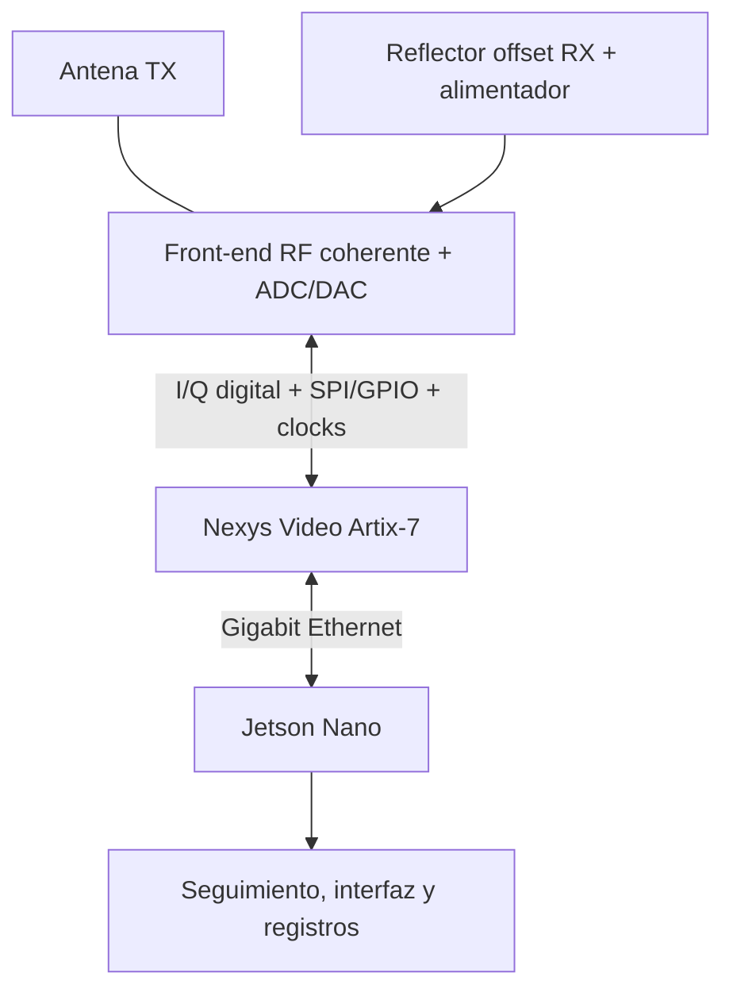

# Arquitectura propuesta

## Responsabilidades

**RF**: síntesis, mezcla, filtros analógicos, ganancias, sincronización y digitalización. **FPGA**: temporización determinista, buffering, filtros, FFT, Doppler y CFAR. **Jetson**: configuración, registro, visualización y seguimiento.

## Interfaces pendientes de diseñar

- **Transceptor ↔ FPGA:** verificar niveles de tensión, LVDS/CMOS, DDR, pines FMC LPC, reloj, SPI y caudal real.
- **FPGA ↔ Jetson:** protocolo Ethernet (propuesta UDP con numeración de paquetes, CRC y marcas de tiempo).
- **Tiempo:** dominios de reloj, PLL, resets y medición de deriva.

## Candidatos de RF

- **AD-FMCOMMS3-EBZ (AD9361):** interfaz FMC LPC conceptualmente afín, **compatibilidad eléctrica/HDL con Nexys Video aún no confirmada** y costo posiblemente fuera del presupuesto.
- **ADALM-PLUTO:** útil en banco para experimentar con FMCW, pero no conecta directamente al FMC de Nexys Video; trae su propia FPGA/SoC.
- **HB100:** detector Doppler económico sin capacidad FMCW programable; **no** es el front-end del radar final de 1 km.

La elección del transceptor es una decisión abierta; ver [ADR](../decisiones/README.md).

[Volver al índice técnico](../README.md)
