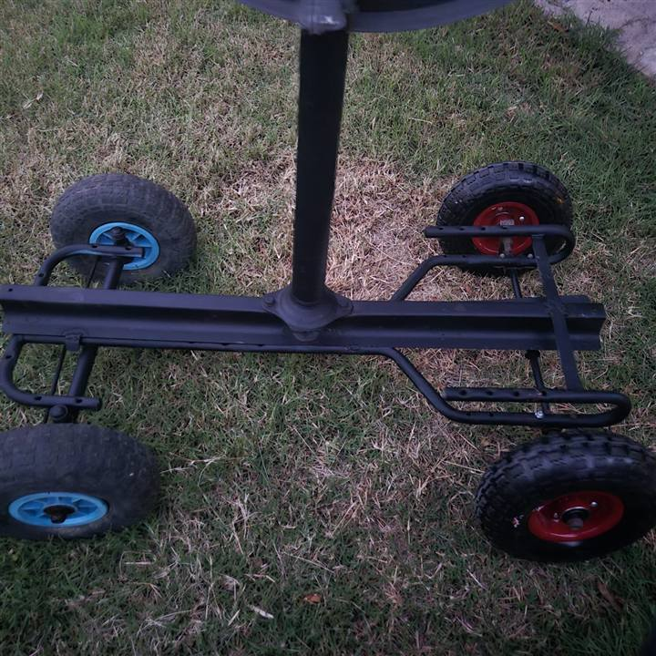
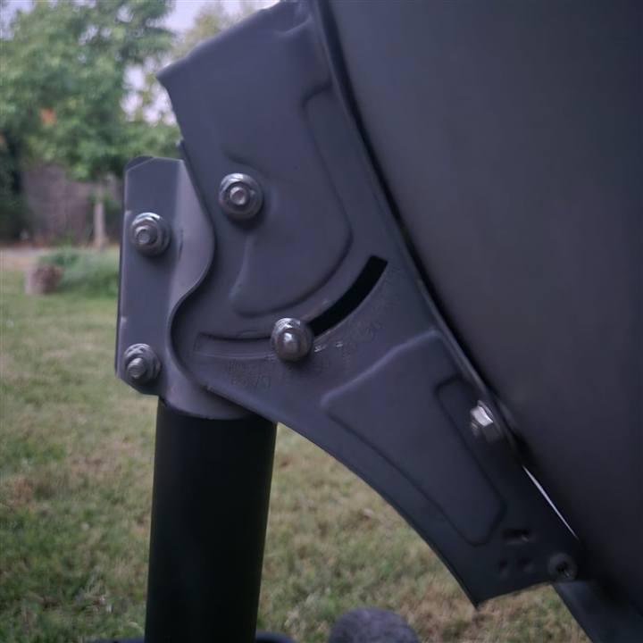

# Base móvil y apuntamiento manual

[Inicio](../../README.md) · [Reflector](reflector-directv.md) · [Hoja de ruta](../../ROADMAP.md)

**Prototipo construido y fotografiado.** Las vistas muestran un carro de cuatro ruedas con larguero central, mástil tubular, reflector offset, brazo del alimentador y soporte de inclinación con ranura curva y perno de fijación. El usuario confirma que azimut y elevación se ajustan manualmente. La interfaz exacta de giro en azimut y sus topes se confirmarán en el levantamiento. El brazo existente sirve como referencia mecánica para ubicar el futuro alimentador.

## Alzado, planta y referencia fotográfica

El alzado identifica **1 480 mm desde el suelo hasta el extremo superior del reflector** en la posición medida. La inclinación de referencia está pendiente de registrar.

| Vista lateral del alzado | Vista frontal del conjunto |
|:---:|:---:|
|  |  |

## Detalle de la pestaña y ruta de cables

**[PROPUESTO]** Desde el alimentador o la caja RF, bajar por el interior del tubo de eje central y continuar por la pestaña del centro del carro hacia el gabinete. El trazo discontinuo indica la ruta prevista. Quedan por comprobar el paso de conectores, la holgura al girar, el radio de curvatura, la sujeción y el sellado.

| Unión del mástil con el carro | Pivote y ranura de elevación |
|:---:|:---:|
|  |  |

## Cotas informadas y medidas pendientes

Las cotas en milímetros proceden del constructor. Los dibujos son esquemáticos. Para completar el plano, usar el suelo como referencia vertical y el centro del mástil como origen en planta.

| ID | Medida a levantar |
|---|---|
| A / B | **900 × 500 mm** exteriores, interpretados como largo y ancho del conjunto con ruedas |
| C / D | **700 mm** entre ejes. Pendiente el ancho entre centros de rueda de cada eje |
| E | Pendiente la altura desde el suelo hasta el centro del pivote de elevación |
| F | Pendientes los diámetros interior y exterior del tubo y la identificación de la unión que se libera para girar en azimut |
| G | **50 × 50 mm** para las dimensiones generales de la pestaña. Pendientes espesor, abertura útil y ubicación exacta respecto al mástil |
| G1 | **50 mm** por aleta lateral. Confirmar la dirección en que se midió esa cota y la otra dimensión de cada aleta |
| H / I | Ancho y alto del reflector. Referencia previa aproximada: 460 × 460 mm, por verificar |
| J | Profundidad en el centro respecto a una regla apoyada sobre el borde. Si es posible, medir en sentido vertical y horizontal |
| K | Avance horizontal y diferencia de altura desde el borde inferior del plato hasta la punta del brazo, con la inclinación de referencia anotada |
| L | Topes manuales de azimut e inclinación, con posición cero y forma de bloqueo |
| M | **1 480 mm** de altura desde el suelo hasta el extremo superior del reflector en la posición medida |

Para detallar la futura motorización, levantar además el patrón de pernos, diámetro del pivote y radio de la ranura medido desde el pivote. En el reflector offset, la inclinación mecánica del plato y la elevación del haz se documentan por separado.
