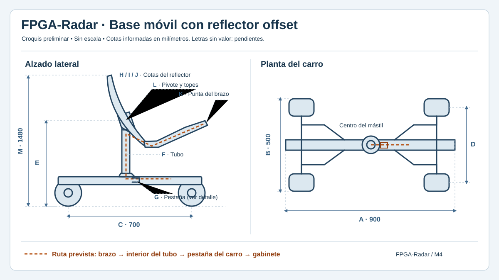
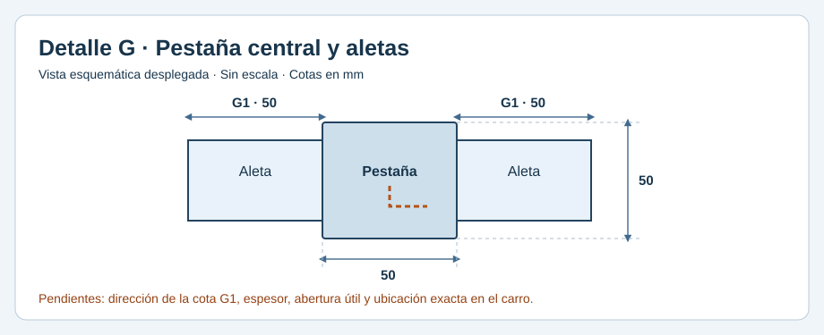

# Base móvil y apuntamiento manual

[Inicio](../../README.md) · [Reflector](reflector-directv.md) · [Hoja de ruta](../../ROADMAP.md)

**Prototipo construido y fotografiado.** Las vistas muestran un carro de cuatro ruedas con larguero central, mástil tubular, reflector offset, brazo del alimentador y soporte de inclinación con ranura curva y perno de fijación. El usuario confirma que azimut y elevación se ajustan manualmente. La interfaz exacta de giro en azimut y sus topes se confirmarán en el levantamiento. El brazo existente sirve como referencia mecánica para ubicar el futuro alimentador.

**[PROPUESTO] Ruta de cables.** Desde el alimentador o la caja RF, bajar por el interior del tubo de eje central y continuar por la pestaña del centro del carro hacia el gabinete. El trazo discontinuo indica la ruta prevista según el constructor. El detalle fotográfico no permite medir la abertura útil de la pestaña. Revisar paso de conectores, holgura al girar, radio de curvatura, sujeción y sellado antes de cerrar el diseño.

| Evidencia fotográfica | Qué se observa |
|---|---|
| [Vista frontal](figuras-base/vista-frontal.jpg) | Reflector, brazo, mástil y carro |
| [Vista lateral](figuras-base/vista-lateral.jpg) | Perfil del reflector y brazo del alimentador |
| [Ajuste de elevación](figuras-base/ajuste-elevacion.jpg) | Ranura curva y tornillería |
| [Detalle del carro](figuras-base/detalle-carro.jpg) | Unión del tubo con el larguero central |

## Cotas informadas y medidas pendientes

Las cotas en milímetros proceden del constructor. Los dibujos son esquemáticos. Para completar el plano, usar el suelo como referencia vertical y el centro del mástil como origen en planta.

| ID | Medida a levantar |
|---|---|
| A / B | **900 × 500 mm** exteriores, interpretados como largo y ancho del conjunto con ruedas |
| C / D | **700 mm** entre ejes. Pendiente el ancho entre centros de rueda de cada eje |
| E | Altura desde el suelo hasta el centro del pivote de elevación |
| F | Diámetros interior y exterior del tubo, e identificar qué unión se libera para girar en azimut |
| G | **50 × 50 mm** para las dimensiones generales de la pestaña. Pendientes espesor, abertura útil y ubicación exacta respecto al mástil |
| G1 | **50 mm** por aleta lateral. Confirmar la dirección en que se midió esa cota y la otra dimensión de cada aleta |
| H / I | Ancho y alto del reflector. Referencia previa aproximada: 460 × 460 mm, por verificar |
| J | Profundidad en el centro respecto a una regla apoyada sobre el borde. Si es posible, medir en sentido vertical y horizontal |
| K | Avance horizontal y diferencia de altura desde el borde inferior del plato hasta la punta del brazo, con la inclinación de referencia anotada |
| L | Topes manuales de azimut e inclinación, con posición cero y forma de bloqueo |

Para detallar la futura motorización, levantar además el patrón de pernos, diámetro del pivote y radio de la ranura medido desde el pivote. En el reflector offset, la inclinación mecánica del plato y la elevación del haz se documentan por separado.
