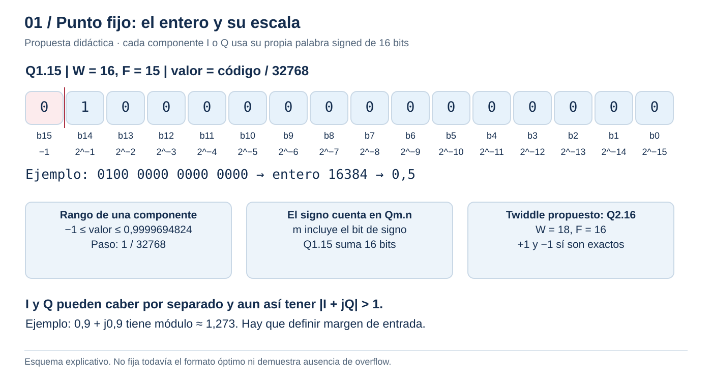
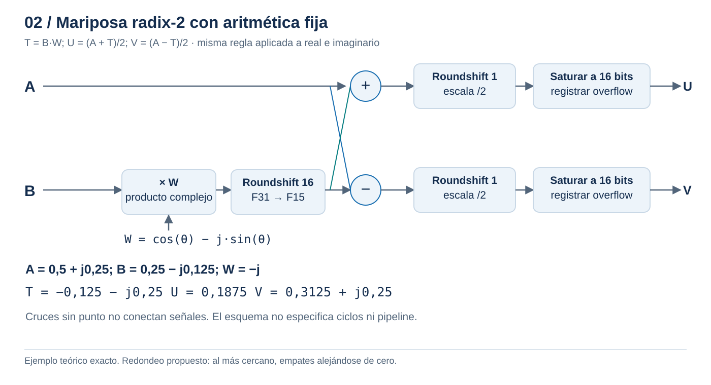
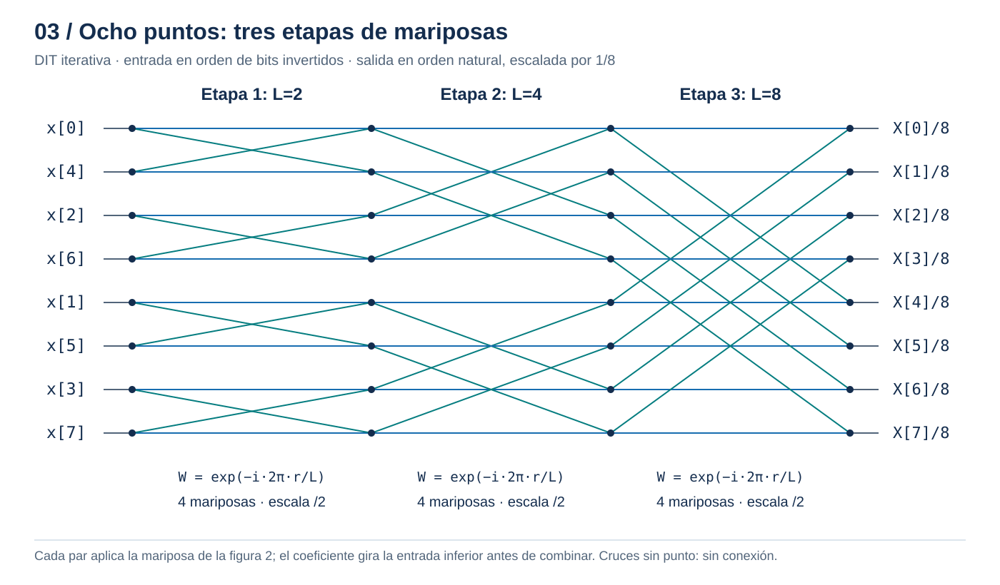
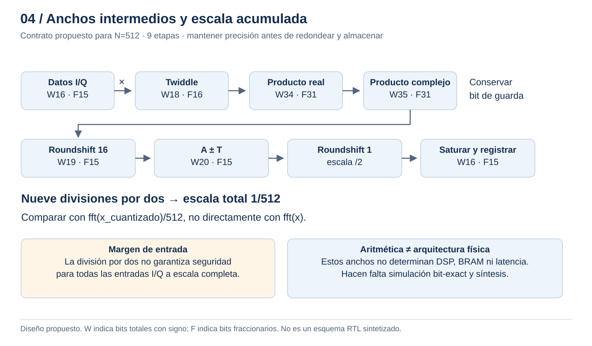

# FFT en punto fijo: de muestras I/Q a mariposas binarias

[Inicio](../../README.md) · [Simulaciones](../../simulation/README.md) · [Subíndice FFT fija](../../simulation/fixed-point/README.md) · [Pipeline](pipeline.md)

**[PROPUESTO]** Contrato numérico inicial para estudiar la FFT de distancia de 512 puntos y, posteriormente, Doppler de 128 puntos. No es un diseño RTL final ni un informe de síntesis. El ejemplo numérico es **[TEÓRICO]**, comprobado con aritmética entera exacta en Python; el archivo MATLAB incluido queda preparado para reproducirlo, sin registrar una ejecución MATLAB de este nuevo ejemplo.

## 1. Qué hace la FFT en nuestro radar

Una reflexión de un chirp FMCW, después de dechirp, produce una oscilación compleja. La FFT separa las frecuencias presentes en una ventana de muestras: cada celda o *bin* acumula la coincidencia con una sinusoide compleja distinta. Un pico es candidato a una frecuencia de batido; la detección requiere además umbral, controles y asociación.

$$X[k]=\sum_{n=0}^{N-1}x[n]e^{-j2\pi kn/N},\qquad x[n]=I[n]+jQ[n].$$

Para el perfil actual, Fs=2 MS/s y N=512: cada bin representa Fs/N=3.906,25 Hz. Con S=78,125 × 10^9 Hz/s, el espaciado de rango es c*Fs/(2*S*N)=7,495 m. La resolución física depende del tiempo/banda observados y de la ventana, no solo del número de bins. Los 32 ceros añadidos a las 480 muestras no crean información nueva.

En Doppler se transforma la secuencia del mismo bin de rango entre chirps. Esa segunda FFT requiere su propio control de escala; no vuelve a ganar gratuitamente la SNR atribuida a las mismas muestras.

## 2. Qué significa punto fijo

Se almacena un entero con signo `q`; el número representado es `q / 2^F`. El punto binario es una convención de interpretación: no ocupa un bit adicional. En este proyecto **Qm.n incluye el signo dentro de m**; para evitar ambigüedad también se escriben siempre W (ancho total), F (bits fraccionarios) y signed.

| Señal propuesta | Representación | Intervalo | Paso |
|---|---|---|---|
| I y Q, cada componente | signed W=16, F=15, Q1.15 | −1 a 1−2^-15 | 2^-15 ≈ 0,000030518 |
| Parte real e imaginaria de W, cada una | signed W=18, F=16, Q2.16 | −2 a 2−2^-16 | 2^-16 ≈ 0,000015259 |

Ejemplos de I: código 16384 representa 0,5; −8192 representa −0,25; 32767 representa 0,9999694824. El número +1 no cabe en Q1.15. Se propone Q2.16 para los coeficientes de giro (*twiddles*) porque permite representar exactamente +1 y −1. El uso de 18 bits no es una conclusión sobre recursos DSP o precisión óptima: debe evaluarse.

Que I y Q quepan individualmente no garantiza que |I+jQ|≤1. Por ejemplo 0,9+j0,9 tiene módulo aproximado 1,273. Para las primeras pruebas sin saturación se propone limitar el módulo de entrada a 0,5; se probarán aparte señales de estrés.

## 3. La mariposa: operación elemental

La descomposición radix-2 reorganiza sumas de la DFT en etapas. Cada mariposa combina dos valores complejos A y B y un coeficiente W=exp(−j2πk/L), donde L es el tamaño del grupo de esa etapa:

$$T=B\,W,\qquad U=(A+T)/2,\qquad V=(A-T)/2.$$

La división por dos forma parte de la propuesta de escalado. La mariposa sin escalar omitiría esas divisiones. La elección DIT (*decimation in time*) sitúa la multiplicación por W antes de la suma/resta. Este esquema es lógico; las líneas no especifican ciclos ni registros.

La multiplicación compleja se descompone en operaciones reales:

$$T_r=B_rW_r-B_iW_i,\qquad T_i=B_rW_i+B_iW_r.$$

No basta con aplicar `int16(fft(x))`: así solo se cuantizaría el resultado de una FFT flotante. La referencia fija debe redondear en los puntos definidos y limitar los anchos en cada etapa.

## 4. Una mariposa calculada a mano

Tomamos A=0,5+j0,25; B=0,25−j0,125; W=−j. Todos son representables exactamente en los formatos propuestos.

| Paso | Códigos enteros (real, imaginario) | Valor interpretado |
|---|---|---|
| A, F=15 | (16384, 8192) | 0,5+j0,25 |
| B, F=15 | (8192, −4096) | 0,25−j0,125 |
| W, F=16 | (0, −65536) | −j |
| Producto complejo, F=31 | (−268435456, −536870912) | −0,125−j0,25 |
| T tras retirar 16 fracciones, F=15 | (−4096, −8192) | −0,125−j0,25 |
| A+T, F=15 | (12288, 0) | 0,375+j0 |
| A−T, F=15 | (20480, 16384) | 0,625+j0,5 |
| U tras dividir por dos, F=15 | (6144, 0) | **0,1875+j0** |
| V tras dividir por dos, F=15 | (10240, 8192) | **0,3125+j0,25** |

Este ejemplo no tiene error de cuantización ni saturación porque todos sus valores son potencias de dos o combinaciones exactas. No implica que ocurra lo mismo con W=exp(−jπ/4). [Código MATLAB](../../simulation/matlab/demo_fixed_butterfly.m) y [comprobación exacta](../../simulation/fixed-point/check_butterfly.py).

## 5. Cómo se conectan las etapas

Para N=2^s hay s etapas y N/2 mariposas por etapa. La realización DIT iterativa elegida para la futura referencia empieza con entrada en orden de bits invertidos y entrega salida en orden natural. Otras arquitecturas cambian esos órdenes; no se debe asumir que la IP AMD usa este mismo contrato.

Para ocho puntos, la permutación de índices de entrada es [0,4,2,6,1,5,3,7]. Ejemplo: índice binario 001 → 100. Los grupos crecen L=2,4,8; en cada grupo, el elemento r se combina con r+L/2 usando W_L^r (i en la figura representa la unidad imaginaria). La figura agrupa esas conexiones para que pueda leerse sin confundir orden natural con orden invertido.

| FFT del proyecto | Etapas radix-2 | Mariposas/etapa | Total | Escala propuesta |
|---|---:|---:|---:|---:|
| Distancia N=512 | 9 | 256 | 2304 | 1/512 |
| Doppler M=128 | 7 | 64 | 448 | 1/128 |

Son conteos matemáticos. No equivalen a multiplicadores físicos, recursos DSP, latencia o Fmax: una arquitectura puede reutilizar mariposas o ejecutar varias a la vez.

## 6. Escalar, redondear y saturar: tres decisiones distintas

**Escalar** reduce amplitud para controlar crecimiento. Dividir por dos en cada una de nueve etapas produce una salida aproximada a `fft(x)/512`. Dos FFT sucesivas con ese escalado tienen factor total 1/(512*128)=1/65536 en amplitud; la potencia cambia por el cuadrado. Normalización, ventanas y CFAR deben usar unidades coherentes.

**Redondear** decide qué ocurre con bits descartados. En esta referencia didáctica se propone redondeo al más cercano con empates alejándose de cero. Para entero a y desplazamiento s>0:

$$\operatorname{roundshift}(a,s)=\operatorname{sign}(a)\left\lfloor\frac{|a|+2^{s-1}}{2^s}\right\rfloor.$$

Ejemplo: +3/2 → +2 y −3/2 → −2. Un desplazamiento aritmético simple hacia la derecha suele truncar hacia −∞; no es esta regla. El cálculo de |a| debe ensancharse para no desbordar con el entero negativo mínimo. No se afirma que esta regla coincida con la de una IP comercial; redondeo convergente/par es una alternativa a comparar por sesgo.

**Saturar** limita un resultado a [−32768,32767] antes de almacenarlo como 16 bits. El recuento de saturaciones debe acompañar la salida. No usar conversión implícita como sustituto de una política documentada. Ejemplo: el código 40000 se satura a 32767; con wrap de 16 bits se convertiría en −25536, cambiando incluso el signo.

Propuesta conservadora de aritmética para una mariposa:

| Punto | Ancho con signo | F | Tratamiento |
|---|---:|---:|---|
| A/B | 16 | 15 | Extender signo al operar |
| W | 18 | 16 | Coeficiente en ROM versionada |
| Cada producto real | 34 | 31 | Conservar producto completo |
| Suma/resta de dos productos | 35 | 31 | Conservar bit de guarda |
| T después de roundshift(·,16) | 19 | 15 | Sin recorte a 16 todavía |
| A ± T | 20 | 15 | Suma/resta ensanchada |
| Después de roundshift(·,1) | 20 de trabajo | 15 | Escala /2, luego detectar overflow |
| Registro U/V | 16 | 15 | Saturación explícita y contador |

Estos anchos son conservadores, no una optimización final. El microejemplo usa int64 como contenedor y reproduce los puntos de redondeo; no pretende inferir ese ancho completo para cada registro RTL.

**Dividir por dos no garantiza ausencia de saturación para cualquier par complejo de escala completa.** La rotación puede aumentar una componente; además se cuantizan los coeficientes. La documentación AMD analiza este crecimiento. Se deben verificar margen de entrada, patrones extremos, escalado y redondeo conjuntamente; no afirmar seguridad a partir de muestras aleatorias solamente.

## 7. Relación con el procesamiento que ya ejecutamos

En S1, `quantize_iq` limita la entrada, pero `range_doppler` ejecuta ambas FFT en punto flotante. Su normalización es por `sum(ventana_rango)*sum(ventana_doppler)`. Una implementación con escala fija 1/(N*M) no produce directamente la misma amplitud: para compararlas hay que multiplicar la salida escalada por `(N*M)/(sum(wr)*sum(wd))`, usando además las mismas ventanas y muestras. Esta corrección de ganancia no recupera bits perdidos por redondeo.

La ventana también debe cuantizarse en la futura cadena completa. Se propone separar primero FFT sola sin ventana, luego ventana+FFT y finalmente FFT 2D+potencia+CFAR. Un resultado correcto de una mariposa no valida esos pasos posteriores.

## 8. Contrato para la futura implementación

- Entrada/salida compleja, I+jQ, signo del exponente negativo, N fijado por configuración y metadatos de trama.
- Fuentes de coeficientes exactas: ROM con códigos enteros, orden y hash. No regenerar silenciosamente con otra precisión.
- Orden de índices, schedule de escala, reglas de redondeo y saturación compartidos entre referencia y RTL.
- Protocolo valid/ready: transferir solo cuando ambos están activos; mantener datos estables durante stalls.
- Flags de overflow, número de muestras y detección de tramas incompletas. Reset no debe mezclar tramas.
- Fijar latencia y recursos después de elegir arquitectura y verificar, no a partir del diagrama matemático.

No hay aún módulos FFT RTL ni una FFT fija completa verificada. El [plan de pruebas](../../simulation/fixed-point/PLAN.md) define qué falta para avanzar. El [ADR-0006](../decisiones/ADR-0006-fft-punto-fijo.md) conserva este contrato como propuesta revisable.

## Fuentes primarias

Consultadas el 2026-11-14. Los esquemas y el microejemplo de este proyecto son originales; no se copian implementaciones de terceros.

- [AMD PG109 v9.1: algoritmo](https://docs.amd.com/r/en-US/pg109-xfft/Algorithm): descomposición y número de etapas.
- [AMD PG109 v9.1: longitud de palabra finita](https://docs.amd.com/r/en-US/pg109-xfft/Finite-Word-Length-Considerations): crecimiento y estrategias de escala; edición web fechada 2026-07-17.
- [MathWorks: conversión de FFT a punto fijo](https://www.mathworks.com/help/fixedpoint/ug/convert-fast-fourier-transform-fft-to-fixed-point.html): metodología de comparar la referencia, conversiones y escalado. No presupone disponibilidad de Fixed-Point Designer en este proyecto.

[Volver al subíndice FFT](../../simulation/fixed-point/README.md) · [Volver al inicio](../../README.md)
