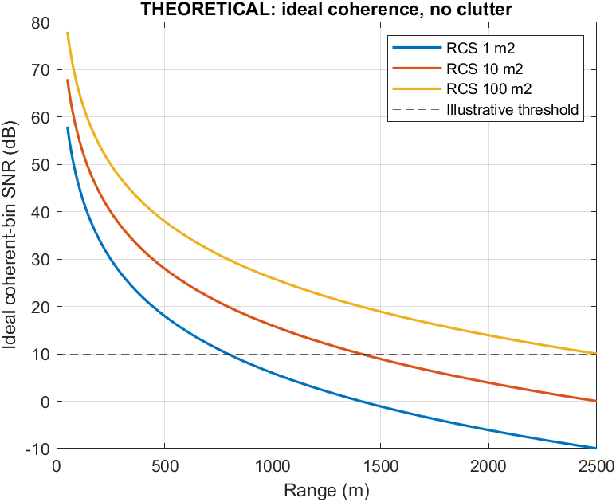
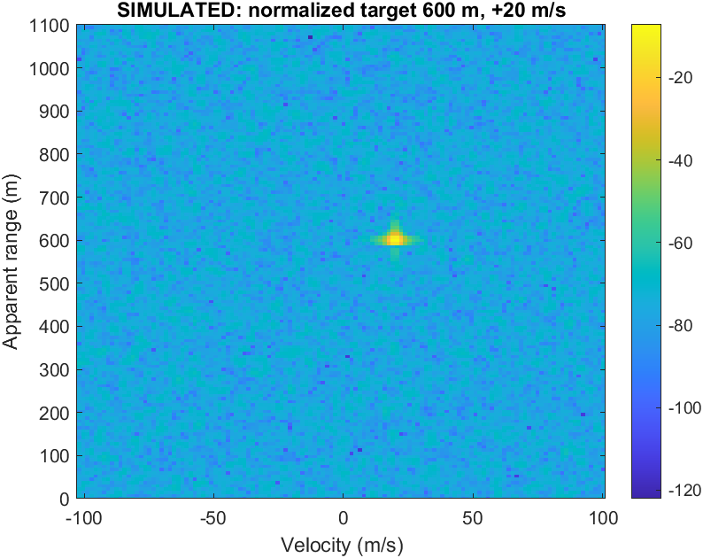

# 2026-11-14 — Primer estudio MATLAB de antena, enlace y procesamiento

[Laboratorio y comandos](../matlab/README.md) · [Frecuencias y arquitectura](../../docs/06-procesamiento/frecuencias-y-modelo-matlab.md) · [Bitácora](../../progress/2026-11-14-simulacion-matlab.md)

## Ejecución y evidencia

**MATLAB R2024b Update 9**, versión 24.2.0.3212159, seed 20261114. Ejecutado en la sesión local del usuario mediante `run_study` tras fallar el arranque batch con error 5202. La ejecución terminó y generó summary.json, study.mat, CSV y dos figuras. No se requirieron toolboxes especializados. Los archivos fuente de esta ejecución se identifican por hashes en el manifiesto.

- [Resumen MATLAB](matlab-inicial/summary.json).
- [27 escenarios teóricos MATLAB](matlab-inicial/sensitivity.csv).
- [Entrada Q1.15 del primer chirp](matlab-inicial/iq_first_chirp_q15.csv), 480 filas I,Q como valores reales normalizados, sin cabecera.
- [Manifiesto SHA-256](matlab-inicial/manifest.json).
- [Resumen independiente Python](matlab-inicial/python-reference.json).

Ocho grupos de aserciones MATLAB aprobados: escalas del enlace, límites de parámetros, blanco estático y Doppler ±, dos blancos separados, cuantización, pico con entrada cuantizada, geometría CFAR y Pfa bajo ruido IID. La referencia Python también pasó ocho comprobaciones; seis métricas de enlace coinciden con MATLAB a tolerancia absoluta 1e-10 o relativa 1e-12. Son pruebas de software/modelos, no mediciones.

## Parámetros y resultados analíticos [TEÓRICO]

| Magnitud | Resultado |
|---|---:|
| Apertura equivalente supuesta | elipse de 0,46 × 0,46 m |
| Eficiencia hipotética | 55 % |
| Frecuencia candidata | 2,45 GHz |
| Ganancia RX calculada | 18,849 dBi |
| B / duración / repetición del chirp | 20 MHz / 256 us / 300 us |
| Muestreo IF / muestras / chirps | 2 MS/s complejas / 480 / 128 |
| FFT distancia / Doppler | 512 / 128 |
| Ventana observada / CPI | 240 us / 38,4 ms |
| Resolución sin ventana por B completo | 7,495 m |
| Resolución por tramo observado, antes del ensanchamiento Hann | 7,994 m |
| Separación de bins Doppler | 1,593 m/s |
| Intervalo de velocidad no ambiguo ideal | ±101,970 m/s |
| Batido máximo para R≤1 km, velocidad≤40 m/s | 521,848 kHz |
| Entrada I/Q 16+16 bits | 64 Mbit/s durante adquisición |
| Trama cruda | 245.760 bytes (240 KiB) |
| Cubo FFT con 32 bits por componente | 524.288 bytes (512 KiB) |
| Objetivo de reloj | 100 MHz, sin síntesis ni timing |
| Ciclos por muestra IF a ese reloj | 50 |

La ventana Hann ensancha los lóbulos: 7,994 m y 1,593 m/s no son pruebas de separabilidad con esa ventana. Tampoco son precisión absoluta. El conteo de 524.288 mariposas por trama no incluye control, memoria, latencias, CFAR o filtrado.

## Alcance energético: sensibilidad, no demostración

Supuestos adicionales: TX 0 dBm y 15 dBi; pérdidas 6 dB; NF 6 dB; 290 K; coherencia ideal durante la CPI; ruido complejo blanco con banda equivalente 2 MHz; ganancia de integración con Hann en ambos ejes 44,363 dB; umbral ilustrativo 10 dB. La antena TX es un supuesto separado del único reflector disponible.

| RCS hipotética | SNR ideal en bin a 1 km | Cruce energético de 10 dB |
|---|---:|---:|
| 1 m² | 5,95 dB | 792 m |
| 10 m² | 15,95 dB | 1.409 m |
| 100 m² | 25,95 dB | 2.505 m |

**Los cruces no son alcances operativos:** no incluyen Pd/Pfa requeridas, clutter, fuga TX/RX, ruido de fase, multitrayectoria, scalloping ni errores de calibración. El perfil solo se verifica hasta 1 km, y el comienzo de adquisición a 8 us limita el eco completo del mismo chirp a unos 1.199 m. Los cruces superiores quedan fuera de esas condiciones. No se demuestra detección real a 1 km.

Con ganancia TX fija y apertura RX constante, aumentar frecuencia incrementa G_rx pero reduce lambda² en la ecuación radar, cancelándose ambos efectos en este modelo. Elegir banda requiere transceptor, alimentador, RCS, pérdidas, disponibilidad y condiciones de uso; estas simulaciones no aprueban una banda RF.

## DSP con datos sintéticos [SIMULADO]

Blanco normalizado: 600 m, velocidad positiva 20 m/s, amplitud 0,5 y potencia de ruido complejo 0,001. MATLAB estima **598,935 m y 20,713 m/s** al corregir acoplamiento rango-Doppler. La cuantización de entrada Q1.15 produjo **0 componentes saturadas** para este caso. FFT y CFAR siguen en punto flotante.

Este mapa usa SNR normalizada para probar matemática; **no usa la amplitud física del enlace** y no valida sensibilidad a 600 m. Eje vertical: rango aparente; estimación citada: rango corregido por Doppler.

CA-CFAR independiente con 16 celdas de entrenamiento, Pfa objetivo 0,01 y 50.000 ensayos IID exponenciales: Pfa observada 0,01012 (506 falsas alarmas). Error estándar aproximado 0,000445; intervalo normal orientativo 95 % ≈ [0,00925; 0,01099]. No extrapolar a celdas correlacionadas por ventanas ni a clutter. CFAR 1D se prueba aislado, no como detector 2D completo del mapa.

## Siguiente iteración

1. Elegir arquitectura de dechirp: analógica o digital a tasa alta; la IF de 2 MS/s ya presupone mezcla y filtro.
2. Vincular amplitudes y ruido del simulador al enlace, introducir fuga y clutter, medir Pd(SNR) con CFAR 2D y estadística apropiada.
3. Añadir FFT bit-exact y crecimiento/escalado de palabras; exportar vectores completos para testbench SystemVerilog.
4. Sintetizar los primeros bloques con objetivo 100 MHz y comprobar memoria, recursos y timing.

Fuentes primarias: [Digilent, oscilador de placa, sección 5](https://digilent.com/reference/_media/nexys-video%3Anexys_video_rm.pdf), [MathWorks, dechirp y estimación FMCW](https://www.mathworks.com/help/phased/ug/fmcw-range-estimation.html). El reporte distingue resultados teóricos/sintéticos de evidencia experimental, que continúa ausente.
